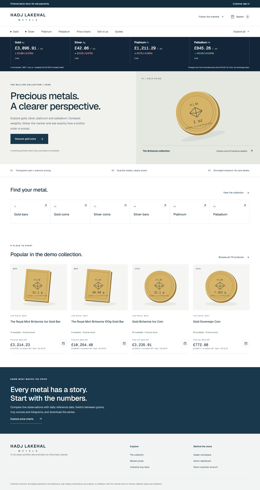
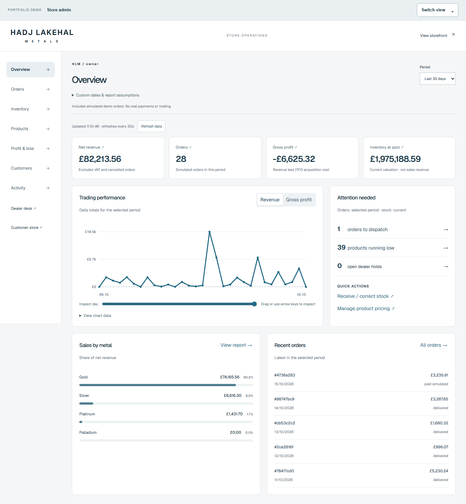

# Bullion Market

A fictional bullion storefront and owner workspace built with **React, TypeScript, Express and PostgreSQL**. Browse 110 products across four metals, lock a price, place a simulated order and follow its stock allocation through the owner's reports.

[CI checks](https://github.com/TahaHL/bullion-market/actions) · [Architecture and decisions](docs/STORE_ARCHITECTURE.md) · [Portfolio case study](docs/CASE_STUDY.md)

**[Open the hosted demo](https://aurum-register-demo.onrender.com/)** — the HLM store is deployed on a free Render instance. It may take a minute to wake after inactivity. Use **Switch view** to explore the customer store and owner dashboard.

No real payments, card details or shipping. Stock and orders are fictional. Built with AI assistance; implementation decisions and verification limits are documented.




## Try it locally

Requires Node 24+:

```sh
npm ci
npm run dev
```

Open http://127.0.0.1:5187. Persistent local PGlite requires no database installation. Prices use free public endpoints; no paid API key is needed. The first launch fetches reference history and seeds the catalogue, so startup can take longer than subsequent launches. For a fully offline, explicitly simulated feed, set `PRICE_PROVIDER=fixture`.

Use **Switch view** at the top:

- **Customer store:** browse metals, quantity tiers and the basket.
- **Customer account:** enter as a fictional customer and see your orders/holdings.
- **Owner demo · Admin:** enter the fictional owner workspace directly.
- **Dealer desk:** issue fixed-price gold quotes, reserve stock, record sales/releases and inspect buy-backs.

The default local API uses port 3107. Restart the backend after server changes; frontend edits use Vite HMR. Localhost is only available on the machine running it.

## What it demonstrates

- Decimal pricing with integer pence, milligrams and basis points; per-product quantity tiers and separate VAT.
- Four independently cached metal feeds and reference charts. Live/1D contains actual collected observations; longer periods use labelled daily reference data.
- Separate customer/dealer identities, scrypt passwords, server sessions, origin checks and server-enforced owner/staff permissions.
- Immutable ten-minute checkout locks. Native PostgreSQL row locks allocate lots FIFO without consuming reserved stock. Stock, order lines, allocations and audit events commit atomically.
- Retry-safe checkout and owner cancellation that restores the exact original allocations once.
- Owner charts, inventory cost/spot valuation, realised FIFO profit, CSV and current stock alerts. Staff do not receive cost or profit fields.

## Key decisions

A price lock guarantees a price until expiry, not stock. Checkout checks availability again inside the transaction. Lots lock in `(product_id, acquired_at, id)` order to keep concurrent requests consistent. Expiry is checked after waiting for locks.

Money is stored as integer pence. Displayed unit prices reconcile with line totals; VAT is separate from revenue. Unknown acquisition costs remain unknown rather than creating misleading profit.

PGlite makes local setup easy but does not prove multi-connection race safety. The native test suite and CI PostgreSQL service exercise competing checkout requests.

The dealer ticket stays separate from catalogue checkout: packs, quantity tiers and VAT must not accidentally pass through the older single-item gold quote calculation.

## Verification

```sh
npm run typecheck
npm test
npm run build
npx playwright install chromium
npm run test:browser
```

Set `TEST_DATABASE_URL` to an isolated native PostgreSQL database to run the six concurrency tests; they skip in PGlite-only runs. Tests create disposable random schemas. CI provisions PostgreSQL 18 and runs the full domain/API and browser suites. Consult the linked workflow for the exact pushed revision rather than treating earlier passing runs as current evidence.

Browser coverage includes checkout/cancellation, pricing controls, view switching, chart controls, authentication, staff data restrictions, responsive layouts and axe accessibility scans. Automated scans do not establish complete accessibility conformance.

## Scope and limitations

This is a portfolio demo, not an operating bullion business. Product specifications are supplied sample data and have not all been verified against mint sources. Original SVG illustrations are not product photographs. The tax model is deliberately simplified; see the architecture document.

Public feeds can fail or become stale; new executable locks then pause. No fabricated market history is silently substituted. Seeded sales are explicitly simulated. Customer order timelines, guides, email, password recovery, shipping integrations and real payments are not complete production features.

[Deployment notes](docs/DEPLOYMENT.md). Existing hosting configuration requests only a free Render web service and an external database. Auto-deployment is disabled. No paid upgrade is authorised. Internal database/login names and the existing remote URL are retained for compatibility.
