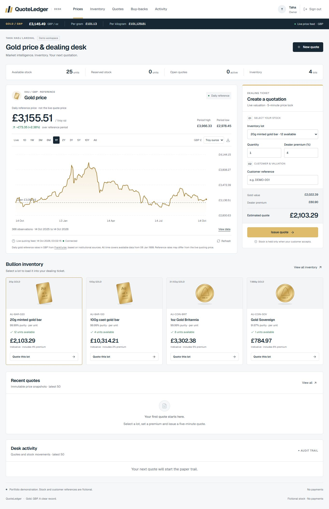

# QuoteLedger

A fictional precious-metals dealer desk built with React, TypeScript, Express and PostgreSQL. It connects pricing to physical inventory: issue a fixed-price quote, reserve stock, record a sale or release the hold. Buy-back offers bring assessed customer gold into inventory after owner inspection.

All stock and customer references are fictional. No money is collected, transferred or verified. Built with AI assistance; the business rules and verification limits below are explicit.



## Run locally

Node 24 or later:

```bash
npm ci
npm run dev
```

Open http://127.0.0.1:5187. The API runs on 3107. The default local database is persistent PGlite in ignored `.local/demo-v2`; no database installation or API key is needed. The previous `.local/preview-postgres` dataset is preserved. Restart the dev process after server edits; frontend changes use Vite HMR.

Choose Enter as owner or Enter as staff. These intentionally public fictional accounts use the normal authentication flow:

| Role | Email | Password | Permissions |
| --- | --- | --- | --- |
| Owner | owner@quoteledger.demo | Demo-owner-2026! | Inventory, premiums, quotes, sale/release and buy-back receipt/cancellation |
| Staff | staff@quoteledger.demo | Demo-staff-2026! | Issue offers and receive new inventory; cannot change existing stock/premiums or close outcomes |

## Dealer workflow

- **Sell:** choose a lot, quantity and premium, then issue a five-minute quote. The price snapshot is immutable. A private customer link accepts it and reserves stock for fifteen minutes. Owner Mark sold decreases total and reserved units together; Release now decreases only reserved units. The expiry worker releases remaining holds automatically.
- **Buy back:** assess weight, purity and quantity; quote spot minus a discount. Customer acceptance starts a fifteen-minute inspection window without changing stock. The owner must confirm the assessment matches before receiving one new lot. Changed assessments need a new offer. Receipt and cancellation are audited and retry-safe.
- **Inventory:** receive lots, correct counts with a reason, and set individual default premiums. Corrections cannot remove held stock. A lot's premium loads into new tickets and catalogue estimates; existing quotes never reprice.
- **Customer pages:** show Taha Hadj Lakehal as dealer, the offer breakdown and next steps. Status refreshes every five seconds until closed. No contact details were supplied, so customers are directed back to whoever sent the link.
- **Activity:** append-only records include actor, reason, quantity, original quoted value and stock counts where relevant.

Fresh demo stock includes a 20g bar, 100g bar, Gold Britannia and Sovereign with sample premiums of 4%, 2%, 5% and 6%. Scrap is assessed through Buy-backs rather than seeded as a retail-premium quote. Product weights and purity use the application's stated precision and fictional sample quantities.

## Prices and charts

The server retrieves GBP gold prices from Gold-API.com every thirty seconds and publishes updates through SSE. Failed providers never silently substitute fictional data. `PRICE_PROVIDER=fixture` selects an explicitly simulated offline feed; optional `PRICE_PROVIDER=goldapi` requires a server-only `GOLDAPI_KEY` and its key-backed delivery remains unverified.

Live and 1 day show actually collected observations, not invented intraday backfill. Longer ranges use Frankfurter daily XAU/GBP reference data: 1 week, 3 months, 6 months, 1 year, 2 years, 3 years, 5 years, 10 years and All time. The available reference series starts 6 January 1999. Reference prices are labelled separately and never execute a quote. Historical data is cached for six hours; recorded intraday observations are retained for seven days. Gaps break the line. Keyboard inspection, a data table, unit conversion and CSV export are supported. At most 500 sampled real points preserve endpoints and extrema; CSV exports the plotted observations.

**Weekend policy:** new live-price offers pause Friday 21:00 UTC through Sunday 22:00 UTC. This is QuoteLedger's conservative desk schedule, not a provider market-status claim. Quotes also require a provider observation less than 120 seconds old after reopening. Existing locked offers and stock actions retain their normal expiry rules. Fixture mode remains available all week. Actual Saturday provider timestamp behavior has not been observed; `npm run check:price` collects a read-only observation. See [operations](docs/DEPLOYMENT.md).

## Key engineering decisions

- Weight is integer milligrams; fineness is parts per 10,000; premiums/discounts are basis points. Decimal.js handles arithmetic. Money rounds half-up at the final pence boundary. One troy ounce is 31.1034768g.
- Example: 10g, 99.99% gold, fictional £2,100/oz and 3% premium gives £675.10 base + £20.25 = £695.35. A 3% buy-back discount gives £654.85. Breakdowns reconcile exactly in pence.
- Acceptance locks quote then inventory lot. Sale/release locks reservation then lot, matching expiry cleanup. Expiry is checked after waiting for locks. Stock changes and audit events commit in the same transaction.
- Durable request IDs make acceptance, inventory receipt/correction and final outcomes retry-safe. Changed payloads with reused IDs fail. A buy-back receipt creates stock only once. PGlite's single session cannot prove native concurrent-client behavior.
- Database triggers protect price snapshots and append-only events. Dealer-scoped queries and composite foreign keys protect tenant boundaries. Role checks are enforced in domain methods, not only hidden buttons.
- Passwords use salted scrypt. Sessions use a database store, signed HttpOnly/SameSite cookies and an absolute eight-hour lifetime. Login regenerates session IDs; logout invalidates them. Mutations require the configured Origin and JSON. Customer tokens are hashed at rest.
- Production requires a native DATABASE_URL, HTTPS origin and a persistent session secret. Demo accounts are off by default in production; the Render fictional demo enables them explicitly.

These are implementation notes. Before an interview, explain the rules in your own words and trace one acceptance, one completed sale and one buy-back receipt through the code.

## Verification

```bash
npm run typecheck
npm test
npm run build
npx playwright install chromium
npm run test:browser
```

Local result: **66 unit/domain/API tests pass; five native PostgreSQL race tests skip without TEST_DATABASE_URL.** Typecheck/build pass. The 15 browser scenarios cover buying/receiving, premiums, selling/releasing, authentication, inventory, chart ranges, responsive layouts and automated axe checks. Browser tests use a separate port and timestamped database by default.

Set TEST_DATABASE_URL to a disposable native PostgreSQL database for all five race tests. They cover final-unit acceptance, receipt retries, sale retries, sale-versus-release and buy-back receipt retries in an isolated schema. CI provisions PostgreSQL 18 and runs these plus the browser suite. Native startup is blocked by the local Windows sandbox; GitHub CI evidence is recorded after publication. An external review reported successful earlier reservation stress tests, but that is not a substitute for running the current suite.

## Deployment

[Render configuration and limitations](docs/DEPLOYMENT.md). `render.yaml` requests only a free web service and free PostgreSQL database, with generated session secret, internal database access and deployment after passing CI. The database expires after 30 days; free services sleep when idle. Hosted publication is verified separately from local checks. Docker configuration is supplied but has not been run locally because Docker is unavailable.

## Code map and limitations

- `server/ledger.ts`: inventory, sales, reservations and atomic outcomes.
- `server/buybacks.ts`: assessed purchase offers, acceptance and inspected receipt.
- `shared/pricing.ts`, `shared/market-hours.ts`: arithmetic and explicit dealing policy.
- `server/auth.ts`: authentication and sessions.
- `server/prices.ts`, `price-history.ts`, `historical-gold.ts`: feed, observations and reference history.
- `src/components/`: dealer/customer views, forms, chart and audit history.
- `src/styles.css`: one consolidated stylesheet, with 328 shadowed declarations removed. Mobile places the dealing ticket above the chart and keeps quote actions visible.
- `server/migrations/`, `tests/`: database integrity and behavior checks.

Current lists cap inventory at 200 lots and each history at 50 records. Search covers loaded lots only. Partial sales, reversals, payments, refunds, taxes, shipping, account provisioning and password reset are outside this fictional release. Historical design/review documents under docs describe earlier milestones; this README describes the current implementation.
